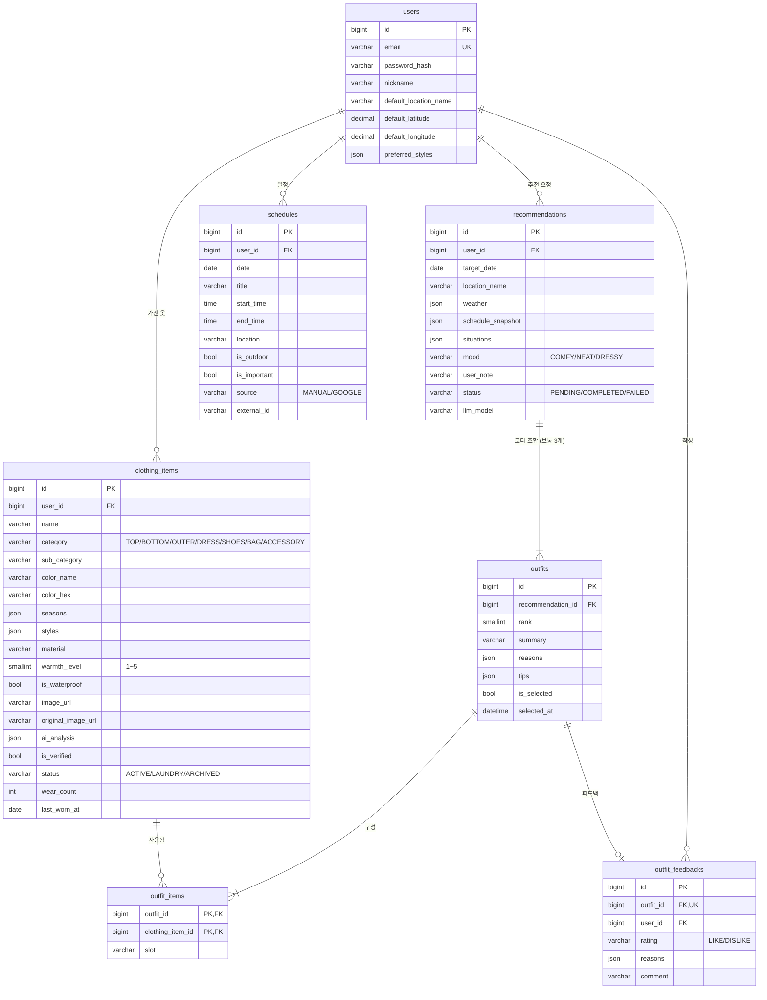

# DB 설계 — 오늘 뭐 입지?

- DBMS: **MySQL 8.0** (utf8mb4)
- 스키마 관리: SQLAlchemy 모델(`backend/app/models`) → Alembic 마이그레이션
- 참고용 DDL: [`schema.sql`](./schema.sql)

## ERD



## 테이블별 역할과 기능 매핑

| 테이블 | 역할 | 계획서 기능 |
|---|---|---|
| `users` | 회원, 날씨 조회용 기본 위치 | 공통 |
| `clothing_items` | 내 옷장. Vision AI 분석 결과 + 사용자 검수 결과 | ① AI 옷장 등록 |
| `schedules` | 직접 입력하거나 캘린더에서 가져온 일정 | ② 날씨·일정 코디 추천 |
| `recommendations` | 추천 요청 1회. 당시 날씨·일정·상황을 **스냅샷**으로 저장 | ② |
| `outfits` | 요청 1회에서 나온 코디 조합(순위별) + 추천 이유·팁 | ② · ③ 스타일리스트 가이드 |
| `outfit_items` | 코디 ↔ 옷 N:M 연결 | ② |
| `outfit_feedbacks` | 좋아요/아쉬워요 + 이유 — 다음 추천 프롬프트에 반영 | ③ 피드백 |

## 설계 포인트

**1. 추천 흐름이 테이블에 그대로 대응돼요**
`POST 추천 요청` → `recommendations`(PENDING) 생성 → LLM이 옷 ID 조합 반환 → `outfits` + `outfit_items` 저장 → 가이드 생성 → `reasons`/`tips` 채우고 COMPLETED.

**2. LLM 입력용 옷 목록은 이 쿼리 하나면 돼요**
```sql
SELECT id, name, category, sub_category, color_name, seasons, styles, warmth_level, is_waterproof
FROM clothing_items
WHERE user_id = ? AND status = 'ACTIVE' AND is_verified = 1;
```
LLM이 돌려준 ID는 반드시 이 목록 안에 있는지 서버에서 검증하세요. 계획서의 "보유 옷만으로 조합"을 보장하는 장치예요.

**3. `warmth_level`, `is_waterproof`는 날씨 매칭용이에요**
"체감 12°, 오후 비" 같은 조건을 LLM이 판단할 때 근거가 돼요. LLM에 넘기기 전에 SQL로 1차 필터링하는 데도 쓸 수 있어요(예: 25° 이상이면 `warmth_level <= 2`만).

**4. 태그는 JSON 배열로 저장해요**
`seasons`, `styles`, `situations` 같은 다중값은 별도 테이블 대신 MySQL JSON 컬럼에 저장해요. 검색은 이렇게 하면 돼요.
```sql
SELECT * FROM clothing_items WHERE user_id = ? AND 'FALL' MEMBER OF (seasons);
```
옷이 많아져 느려지면 다중값 인덱스를 추가하면 돼요: `CREATE INDEX ix_ci_seasons ON clothing_items ((CAST(seasons AS CHAR(10) ARRAY)));`

**5. 스냅샷과 원본을 분리해요**
- `recommendations.weather`, `schedule_snapshot`: 나중에 일정이 바뀌어도 "그날 왜 이걸 추천했는지"가 남아요.
- `clothing_items.ai_analysis`: Vision AI 원본 응답. 사용자가 고친 값과 비교하면 프롬프트 개선 근거가 돼요.

**6. 삭제 정책**
- 옷은 보통 `status = 'ARCHIVED'`로 숨기고(추천 기록 유지), 정말 지울 때만 DELETE 해요(관련 `outfit_items`도 함께 삭제).
- 회원 탈퇴 시 모든 데이터가 CASCADE로 삭제돼요.

## 코드 값

| 컬럼 | 값 |
|---|---|
| `category`, `outfit_items.slot` | TOP 상의 · BOTTOM 하의 · OUTER 아우터 · DRESS 원피스/셋업 · SHOES 신발 · BAG 가방 · ACCESSORY 액세서리 |
| `seasons` 요소 | SPRING · SUMMER · FALL · WINTER |
| `clothing_items.status` | ACTIVE 사용 가능 · LAUNDRY 세탁 중 · ARCHIVED 보관 |
| `recommendations.mood` | COMFY 편하게 · NEAT 단정하게 · DRESSY 꾸민 듯 |
| `outfit_feedbacks.reasons` 예시 | TOO_COLD · TOO_HOT · TOO_FORMAL · TOO_CASUAL · IN_LAUNDRY · DONT_LIKE_COMBO |

ENUM 타입 대신 `VARCHAR + CHECK` 제약으로 저장해요. 값을 추가할 때 마이그레이션이 간단해요.
